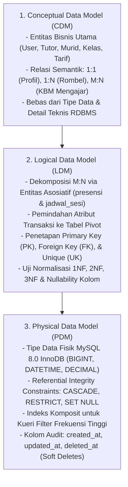
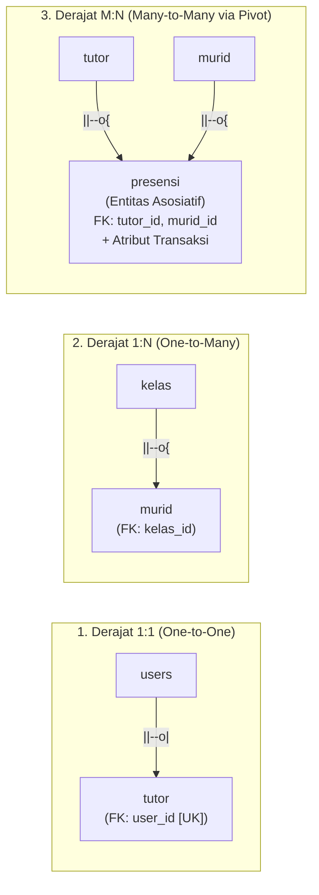

# PERANCANGAN BASIS DATA & ENTITY RELATIONSHIP DIAGRAM (ERD) TERPADU
## Sistem Informasi Presensi & Manajemen Pembelajaran PKBM Pikat

---

### 1. INFORMASI & METADATA DOKUMEN

- **Nama Sistem:** Sistem Informasi Presensi PKBM Pikat (Versi 2)
- **Modul / Lingkup:** Seluruh Basis Data Sistem Relasional (Autentikasi, Akademik, Presensi, Jadwal, Payroll Honor SK, & Izin)
- **Tipe Diagram:** Physical Data Model (PDM) & Logical Data Model (LDM)
- **Standar Notasi:** Crow's Foot Notation (Mermaid.js `erDiagram` UML/Relational Standard)
- **RDBMS Engine:** MySQL 8.0 (InnoDB Engine) / SQLite Terkompatibilitas
- **Arsitektur Framework:** Laravel 12 (PHP 8.5)
- **Status Dokumen:** **Resmi (Disetujui & Terimplementasi)**
- **Standarisasi Istilah:** Peserta ajar distandarisasi penuh menggunakan entitas **Murid**.

---

### 2. TUJUAN & RUANG LINGKUP PERANCANGAN

Dokumen ini menyajikan model arsitektur basis data relasional untuk platform Presensi PKBM Pikat. Desain ini ditujukan untuk:
1. **Memisahkan Kredensial & Profil (Pola User + Profile):** Menjamin keamanan autentikasi melalui satu tabel `users` tunggal dengan ekstensi peran 1:1 ke entitas `admin`, `tutor`, `kepala_sekolah`, `magang`, dan `murid`.
2. **Menjamin Integritas Histori Finansial SK & Akademik:** Menggunakan mekanisme *Restricted Foreign Keys* dan teknik *Snapshot Pricing* (`nominal_honor_snapshot`) agar perubahan tarif SK di masa depan tidak mendistorsi rekapitulasi penggajian masa lampau.
3. **Mendukung Validasi Multi-Modal Presensi:** Menyimpan log koordinat GPS presisi tinggi, indikator kepalsuan sinyal (`is_mocked` Fake GPS), akurasi radius geofence, bukti foto selfie, dan toleransi keterlambatan shift.
4. **Mencegah Anomali & Redundansi Data:** Memenuhi kaidah normalisasi relasional hingga **Third Normal Form (3NF)**.

---

### 3. TINGKATAN PEMODELAN DATA & TEORI RELASIONAL SISTEM

Perancangan basis data sistem presensi ini dibangun melalui tiga tingkatan abstraksi berurutan:



---

#### 3.1. Konsep Entitas & Atribut pada Sistem Ini

1. **Klasifikasi Entitas**:
   - **Entitas Kuat (*Strong Entity*)**: `users`, `murid`, `kategori_tutorial`, `lokasi_presensi`, `jenjang_paket`. Memiliki Primary Key (`id`) mandiri dan keberadaannya tidak bergantung pada entitas lain.
   - **Entitas Lemah (*Weak Entity*)**: `push_subscriptions`. Eksistensinya bergantung penuh pada entitas `users` (*identifying relationship* dengan aksi `CASCADE on delete`).
   - **Entitas Asosiatif (*Associative Entity*)**: `presensi` dan `jadwal_sesi`. Menjembatani relasi Banyak-ke-Banyak (*M:N*) antara `tutor` dan `murid`, sekaligus mengikat relasi terner dengan `kategori_tutorial` dan `lokasi_presensi`.

2. **Karakteristik & Penanganan Atribut**:
   - **Atribut Sederhana / Atomik**: `tgl_presensi`, `jam_mulai`, `radius_meter`, `status`.
   - **Atribut Komposit (*Composite Attribute*)**: Informasi lokasi dan pengguna dipecah menjadi atribut atomik (`nama_lengkap`, `alamat`, `latitude`, `longitude`).
   - **Atribut Bernilai Banyak (*Multi-Valued Attribute*)**: Pola hari mengajar (misal: "Senin, Rabu, Jumat") **dilarang keras** disimpan dalam satu string teks koma. Atribut ini dinormalisasi ke entitas anak tersendiri: `jadwal_rutin` dengan satu baris per hari.
   - **Atribut Turunan (*Derived / Calculated Attribute*)**:
     - *Dihitung Dinamis*: Durasi sesi dihitung otomatis dari selisih `jam_selesai - jam_mulai` via Accessor model tanpa disimpan redundan.
     - *Pengecualian Terkendali (Snapshot Finansial)*: Kolom `nominal_honor_snapshot` pada `presensi` menyalin `nominal_honor` dari `kategori_tutorial` pada detik transaksi clock-in. Ini menjamin rekap payroll masa lampau tidak berubah saat tarif SK diubah di masa depan.

---

#### 3.2. Derajat Kardinalitas & Modalitas Relasi Sistem



1. **Derajat One-to-One (1:1)**:
   - **Kasus**: Satu akun `users` memiliki tepat satu profil peran (`admin`, `tutor`, `kepala_sekolah`, `magang`).
   - **Modalitas**: *Mandatory-to-Optional* (`||--o|`). Akun `users` wajib ada (`||`), sedangkan profil `tutor` opsional (`o|`) karena akun tersebut bisa berperan lain.
   - **Aturan FK**: Kolom `user_id` diletakkan di tabel profil anak dan **WAJIB DIBERI CONSTRAINT UNIQUE (`UK`)** agar tidak ada duplikasi profil untuk satu akun login yang sama.

2. **Derajat One-to-Many (1:N)**:
   - **Kasus**: Satu rombel `kelas` menampung banyak `murid`. Satu master `kategori_tutorial` digunakan oleh banyak rekaman `presensi`. Satu titik `lokasi_presensi` digunakan oleh banyak sesi presensi.
   - **Modalitas**: *Mandatory-to-Optional Many* (`||--o{`). Entitas induk wajib ada (`||`), sedangkan entitas anak boleh 0 atau banyak (`o{`).
   - **Aturan FK**: **Foreign Key SELALU berada di sisi "Many" (tabel anak)**: `murid.kelas_id`, `presensi.tutor_id`, `presensi.kategori_tutorial_id`.

3. **Derajat Many-to-Many (M:N / N:M)**:
   - **Kasus Bisnis Konseptual**: Satu `tutor` mengajar banyak `murid`, dan satu `murid` dapat dibimbing oleh banyak `tutor` (untuk mata pelajaran atau bidang vokasi berbeda).
   - **Kendala Relasional**: RDBMS tidak dapat menyimpan relasi M:N secara langsung tanpa melanggar 1NF.
   - **Solusi Dekomposisi**: Relasi M:N dipecah menjadi dua relasi 1:N melalui entitas asosiatif `presensi` dan `jadwal_sesi`.
   - **Atribut Relasi**: Atribut transaksi (`tgl_presensi`, `jam_mulai`, `jam_selesai`, `foto_mulai`, `nominal_honor_snapshot`, `is_mocked`) diletakkan langsung di dalam tabel pivot `presensi`.

---

---

### 4. DIAGRAM ERD LENGKAP (PHYSICAL DATA MODEL)

Diagram ERD di bawah ini memodelkan seluruh tabel dan relasi relasional sistem menggunakan notasi **Crow's Foot**:

```mermaid
erDiagram
    direction TB

    %% =========================================================================
    %% RELASI DOMAIN 1: AUTENTIKASI, PERAN, & PUSH NOTIFIKASI
    %% =========================================================================
    users ||--o| admin : "memiliki_profil"
    users ||--o| tutor : "memiliki_profil"
    users ||--o| kepala_sekolah : "memiliki_profil"
    users ||--o| magang : "memiliki_profil"
    users ||--o| murid : "memiliki_akun_login"
    users ||--o{ push_subscriptions : "mendaftarkan_device"
    users ||--o{ presensi_karyawan : "melakukan_absensi"
    users ||--o{ pengajuan_izin_sakit : "memverifikasi"

    %% =========================================================================
    %% RELASI DOMAIN 2: STRUKTUR AKADEMIK & MASTER PENDIDIKAN
    %% =========================================================================
    jenjang_paket ||--o{ kelas : "mengelompokkan"
    kelas ||--o{ murid : "memiliki_anggota"
    tutor ||--o{ murid : "sebagai_wali_tutor"

    %% =========================================================================
    %% RELASI DOMAIN 3: OPERASIONAL MASTER & SHIFT
    %% =========================================================================
    kategori_tutorial ||--o{ presensi : "menentukan_tarif_sk"
    kategori_tutorial ||--o{ jadwal_kerja : "menentukan_jam_shift"
    kategori_tutorial ||--o{ jadwal_rutin : "basis_skema_sk"
    kategori_tutorial ||--o{ jadwal_sesi : "basis_skema_sk"

    lokasi_presensi ||--o{ presensi : "geofence_kbm_tutor"
    lokasi_presensi ||--o{ presensi_karyawan : "geofence_staf_magang"
    lokasi_presensi ||--o{ presensi_mandiri_murid : "geofence_kehadiran_murid"
    lokasi_presensi ||--o{ jadwal_rutin : "lokasi_rutin_kbm"
    lokasi_presensi ||--o{ jadwal_sesi : "lokasi_sesi_kbm"

    jadwal_kerja ||--o{ presensi : "mengikuti_shift"
    jadwal_kerja ||--o{ presensi_karyawan : "mengikuti_shift"
    jadwal_kerja ||--o{ jadwal_rutin : "pola_shift"
    jadwal_kerja ||--o{ jadwal_sesi : "pola_shift"

    %% =========================================================================
    %% RELASI DOMAIN 4: PENJADWALAN KBM (RUTIN & SESI)
    %% =========================================================================
    tutor ||--o{ jadwal_rutin : "mengampu_mingguan"
    murid ||--o{ jadwal_rutin : "menerima_mingguan"

    jadwal_rutin ||--o{ jadwal_sesi : "menghasilkan_sesi"
    tutor ||--o{ jadwal_sesi : "mengampu_sesi"
    murid ||--o{ jadwal_sesi : "menghadiri_sesi"

    tutor ||--o{ jadwal : "legacy_agenda"
    murid ||--o{ jadwal : "legacy_agenda"

    %% =========================================================================
    %% RELASI DOMAIN 5: REKAM PRESENSI TERPADU
    %% =========================================================================
    tutor ||--o{ presensi : "mencatat_kehadiran"
    murid ||--o{ presensi : "menghadiri_kbm"
    jadwal_sesi ||--o| presensi : "direalisasikan_oleh"

    murid ||--o{ presensi_mandiri_murid : "mencatat_absensi_harian"

    %% =========================================================================
    %% RELASI DOMAIN 6: PERIZINAN & RETROAKTIF
    %% =========================================================================
    tutor ||--o{ pengajuan_lupa_lapor : "mengajukan_susulan"
    murid ||--o{ pengajuan_lupa_lapor : "sebagai_subjek"
    tutor ||--o{ pengajuan_izin_sakit : "mengajukan_cuti_sakit"

    %% =========================================================================
    %% DEFINISI ENTITAS FISIK
    %% =========================================================================

    users {
        bigint id PK
        string nik UK "Nomor Induk Karyawan / Identitas Unik"
        string nama_lengkap "Nama Lengkap Pengguna"
        string email UK "Email Akun Login"
        string password "Hashed Password"
        string role "admin | tutor | kepala_sekolah | murid | magang"
        string no_hp "Nomor WhatsApp Kontak"
        string foto "Path Berkas Foto Profil"
        boolean is_active "Status Akun Aktif (1=Aktif, 0=Nonaktif)"
        timestamp email_verified_at "Nullable"
        timestamp created_at
        timestamp updated_at
    }

    admin {
        bigint id PK
        bigint user_id FK,UK "Relasi 1:1 ke users"
        string nik UK "Nomor Induk Pegawai"
        string nama_lengkap "Nama Lengkap Administrator"
        string email "Email Kontak"
        string no_hp "Nomor WhatsApp"
        string foto "Path Berkas Foto Profil"
        timestamp created_at
        timestamp updated_at
    }

    tutor {
        bigint id PK
        bigint user_id FK,UK "Relasi 1:1 ke users"
        string nik UK "Nomor Induk Tutor"
        string nama_lengkap "Nama Lengkap Tutor"
        string jabatan "Jabatan / Bidang Pengajaran"
        string email "Email Tutor"
        text alamat "Alamat Domisili"
        string no_hp "Nomor WhatsApp Aktif"
        string foto "Path Foto Profil"
        timestamp created_at
        timestamp updated_at
    }

    kepala_sekolah {
        bigint id PK
        bigint user_id FK,UK "Relasi 1:1 ke users"
        string nik UK "Nomor Induk Kepala Sekolah"
        string nama_lengkap "Nama Lengkap Kepala Sekolah"
        string email "Email Resmi"
        string no_hp "Nomor WhatsApp"
        string foto "Path Foto Profil"
        timestamp created_at
        timestamp updated_at
    }

    magang {
        bigint id PK
        bigint user_id FK,UK "Relasi 1:1 ke users"
        string nim_nisn "Nomor Induk Mahasiswa / Pelajar PKL"
        string nama_lengkap "Nama Lengkap Mahasiswa Magang"
        string asal_instansi "Universitas / SMK Asal"
        string jurusan "Bidang / Fakultas"
        string jurusan_prodi "Program Studi Spesifik"
        string pembimbing_lapangan "Nama Pembimbing Eksternal"
        date tgl_mulai "Tanggal Mulai Magang"
        date tgl_selesai "Tanggal Berakhir Magang"
        string status "aktif | selesai | drop_out"
        string no_hp "Nomor Kontak"
        text alamat "Alamat Domisili"
        string foto "Path Foto Profil"
        timestamp created_at
        timestamp updated_at
    }

    push_subscriptions {
        bigint id PK
        bigint user_id FK "Relasi ke users (CASCADE)"
        text endpoint "W3C Web Push Gateway URL"
        string public_key "ECDH Public Key Client"
        string auth_token "Auth Secret Token Client"
        timestamp created_at
        timestamp updated_at
    }

    jenjang_paket {
        bigint id PK
        string kode UK "paket_a | paket_b | paket_c | vokasi"
        string nama_jenjang "Paket A (Setara SD), dsb."
        text keterangan "Deskripsi Kurikulum"
        timestamp created_at
        timestamp updated_at
    }

    kelas {
        bigint id PK
        bigint jenjang_paket_id FK "Relasi ke jenjang_paket (RESTRICT)"
        string nama_kelas "Nama Rombongan Belajar"
        string tingkat "Tingkatan Kelas: 1-12 / Nullable"
        text keterangan "Catatan Tambahan"
        timestamp created_at
        timestamp updated_at
    }

    murid {
        bigint id PK
        bigint user_id FK,UK "Akun Login Murid (Nullable)"
        bigint kelas_id FK "Rombel Kelas (RESTRICT)"
        bigint tutor_id FK "Tutor Pendamping Utama (Nullable)"
        string no_absen "Nomor Urut Presensi Kelas"
        string nisn UK "Nomor Induk Siswa Nasional (Nullable)"
        string nama_murid "Nama Lengkap Peserta Ajar"
        boolean is_abk "Indikator Kebutuhan Khusus"
        string status_murid "aktif | alumni | cuti | nonaktif"
        string no_hp "Nomor HP Murid / Kontak Wali"
        string nama_wali "Nama Orang Tua / Wali"
        timestamp deleted_at "Soft Deletes"
        timestamp created_at
        timestamp updated_at
    }

    kategori_tutorial {
        bigint id PK
        string nama_kategori "Nama Sesi SK (Mandiri, ABK, dll)"
        string jenis_layanan "komunitas | dl | lainnya"
        decimal durasi_jam "Durasi Default Sesi (misal: 1.5, 2.0)"
        boolean is_abk "Tarif Khusus Murid ABK"
        boolean is_gabungan "Indikator Pembelajaran Gabungan"
        decimal nominal_honor "Nominal Honor SK per Sesi (Rp)"
        boolean is_aktif "Status Penawaran Tarif"
        int urutan "Urutan Tampilan Form"
        timestamp created_at
        timestamp updated_at
    }

    lokasi_presensi {
        bigint id PK
        string nama_lokasi "Gedung PKBM Pikat / Titik Komunitas"
        text alamat "Alamat Fisik Lengkap"
        string tipe "sekolah | yayasan | mitra | privat"
        decimal latitude "Garis Lintang GPS"
        decimal longitude "Garis Bujur GPS"
        int radius_meter "Radius Toleransi Geofencing"
        boolean is_active "Status Titik Presensi Aktif"
        text keterangan "Catatan Lokasi"
        timestamp created_at
        timestamp updated_at
    }

    jadwal_kerja {
        bigint id PK
        bigint kategori_tutorial_id FK "Relasi ke kategori_tutorial (Nullable)"
        string nama_shift "Nama Shift Kerja / KBM"
        string kode_shift UK "Kode Unik Shift"
        string jenis_shift "kbm | operasional_kantor | magang"
        time jam_masuk "Jam Standar Masuk"
        time jam_pulang "Jam Standar Pulang"
        decimal durasi_jam "Durasi Kerja Shift"
        int earliest_minutes "Menit Paling Awal Boleh Clock-In"
        int tolerance_minutes "Toleransi Keterlambatan (Menit)"
        boolean is_aktif "Status Shift Aktif"
        int urutan "Urutan Shift"
        text keterangan "Keterangan Jam Kerja"
        timestamp created_at
        timestamp updated_at
    }

    jadwal_rutin {
        bigint id PK
        bigint murid_id FK "Murid Sasaran (RESTRICT)"
        bigint tutor_id FK "Tutor Pengampu (RESTRICT)"
        bigint kategori_tutorial_id FK "Kategori Tutorial SK"
        bigint jadwal_kerja_id FK "Relasi ke jadwal_kerja (Nullable)"
        bigint lokasi_presensi_id FK "Titik Lokasi (Nullable)"
        string hari "senin | selasa | rabu | kamis | jumat | sabtu | minggu"
        time jam_masuk "Rencana Jam Masuk"
        time jam_pulang "Rencana Jam Pulang"
        decimal durasi_jam "Durasi Sesi KBM"
        boolean is_active "Status Pola Aktif"
        date berlaku_mulai "Awal Berlakunya Pola"
        date berlaku_sampai "Akhir Berlakunya Pola (Nullable)"
        text keterangan "Catatan Sesi Rutin"
        timestamp created_at
        timestamp updated_at
    }

    jadwal_sesi {
        bigint id PK
        bigint jadwal_rutin_id FK "Sumber Pola Rutin (Nullable)"
        bigint tutor_id FK "Tutor Pelaksana"
        bigint murid_id FK "Murid Pelaksana"
        bigint kategori_tutorial_id FK "Kategori Tutorial SK"
        bigint jadwal_kerja_id FK "Shift Terkait (Nullable)"
        bigint lokasi_presensi_id FK "Lokasi Terkait (Nullable)"
        date tanggal_rencana "Tanggal Pelaksanaan KBM"
        time jam_masuk_rencana "Jam Mulai Rencana"
        time jam_pulang_rencana "Jam Selesai Rencana"
        decimal durasi_jam "Durasi Sesi Jam"
        string jenis_sesi "rutin | pengganti | insidental"
        date tanggal_asli "Tanggal Asal (Jika Reschedule)"
        text alasan_penggantian "Alasan Reschedule"
        string status "terjadwal | selesai | reschedule | dibatalkan"
        bigint presensi_id FK "Tautan ke presensi Tutor (Nullable)"
        bigint presensi_murid_id FK "Tautan ke presensi Murid (Nullable)"
        string status_kehadiran_murid "hadir | izin | sakit | alpha | belum_presensi"
        text catatan "Catatan Sesi"
        timestamp created_at
        timestamp updated_at
    }

    jadwal {
        bigint id PK
        bigint tutor_id FK "Tutor Pengampu"
        bigint murid_id FK "Murid Sasaran"
        bigint lokasi_presensi_id FK "Lokasi KBM (Nullable)"
        date tanggal "Tanggal Pelaksanaan"
        time jam_mulai "Jam Mulai"
        time jam_selesai "Jam Selesai"
        string status "terjadwal | selesai | dibatalkan"
        text agenda "Materi / Topik Belajar"
        timestamp created_at
        timestamp updated_at
    }

    presensi {
        bigint id PK
        bigint tutor_id FK "Tutor Mengajar"
        bigint murid_id FK "Murid yang Diajar"
        bigint lokasi_presensi_id FK "Titik Geofence (Nullable)"
        bigint kategori_tutorial_id FK "Kategori Tutorial SK"
        bigint jadwal_kerja_id FK "Shift SK Terkait (Nullable)"
        bigint jadwal_sesi_id FK "Sesi Rencana Terkait (Nullable)"
        string moda_pembelajaran "sekolah | kunjungan_rumah | online"
        string link_daring "Link Zoom / GMeet jika Online"
        decimal durasi_pilihan "Durasi Sesi Mengajar (Jam)"
        decimal nominal_honor_snapshot "Snapshot Tarif Honor SK saat Clock-In"
        date tgl_presensi "Tanggal Sesi Berlangsung"
        time jam_mulai "Jam Mulai Mengajar (Clock-In)"
        time jam_selesai "Jam Selesai Mengajar (Clock-Out, Nullable)"
        string foto_mulai "Path Bukti Kamera Masuk"
        string foto_selesai "Path Bukti Kamera Pulang (Nullable)"
        string lokasi_mulai "Koordinat GPS Masuk (Lat, Lng)"
        string lokasi_selesai "Koordinat GPS Pulang (Lat, Lng)"
        decimal lokasi_akurasi "Radius Akurasi GPS (Meter)"
        boolean is_mocked "Deteksi Fake GPS / Mock Location"
        string status "hadir | izin | alpha"
        string shift_nama "Nama Shift Terpilih"
        string status_kehadiran "tepat_waktu | terlambat | lebih_awal"
        int menit_keterlambatan "Selisih Keterlambatan (Menit)"
        timestamp created_at
        timestamp updated_at
    }

    presensi_karyawan {
        bigint id PK
        bigint user_id FK "Akun Staf / Magang / Admin / Kepsek"
        bigint lokasi_presensi_id FK "Lokasi Geofence (Nullable)"
        bigint jadwal_kerja_id FK "Shift Kantor (Nullable)"
        date tgl_presensi "Tanggal Kerja"
        time jam_masuk "Jam Masuk Kantor"
        time jam_pulang "Jam Pulang Kantor (Nullable)"
        string foto_mulai "Path Bukti Foto Masuk"
        string foto_selesai "Path Bukti Foto Pulang (Nullable)"
        string lokasi_mulai "Koordinat GPS Masuk"
        string lokasi_selesai "Koordinat GPS Pulang"
        decimal lokasi_akurasi "Akurasi Sinyal GPS (Meter)"
        boolean is_mocked "Deteksi Fake GPS"
        string status "hadir | izin | sakit | alpha"
        string status_kehadiran "tepat_waktu | terlambat | lebih_awal"
        int menit_keterlambatan "Menit Keterlambatan"
        timestamp created_at
        timestamp updated_at
    }

    presensi_mandiri_murid {
        bigint id PK
        bigint murid_id FK "Murid Bersangkutan"
        bigint lokasi_presensi_id FK "Lokasi Geofence (Nullable)"
        date tgl_presensi "Tanggal Presensi Mandiri"
        time jam_masuk "Jam Masuk Murid"
        time jam_pulang "Jam Pulang Murid (Nullable)"
        string foto_masuk "Path Foto Selfie Masuk"
        string foto_pulang "Path Foto Selfie Pulang (Nullable)"
        string lokasi_masuk "Koordinat GPS Masuk"
        string lokasi_pulang "Koordinat GPS Pulang"
        decimal lokasi_akurasi "Akurasi GPS (Meter)"
        boolean is_mocked "Deteksi Fake GPS"
        string status "hadir | izin | sakit | alpha"
        string status_kehadiran "tepat_waktu | terlambat | lebih_awal"
        int menit_keterlambatan "Menit Keterlambatan"
        timestamp created_at
        timestamp updated_at
    }

    pengajuan_lupa_lapor {
        bigint id PK
        bigint tutor_id FK "Tutor Pengaju"
        bigint murid_id FK "Murid Sasaran"
        date tanggal "Tanggal Sesi Retroaktif"
        time jam_mulai "Waktu Mulai Retroaktif"
        time jam_selesai "Waktu Selesai Retroaktif"
        text alasan "Alasan Terlambat Lapor"
        string status "pending | disetujui | ditolak"
        text catatan_kepsek "Catatan Verifikasi Eksekutif"
        timestamp created_at
        timestamp updated_at
    }

    pengajuan_izin_sakit {
        bigint id PK
        bigint tutor_id FK "Tutor Pemohon"
        bigint disetujui_oleh FK "User Verifikator (Kepsek/Admin, Nullable)"
        string jenis "izin | sakit"
        date tgl_mulai "Tanggal Mulai Izin/Sakit"
        date tgl_selesai "Tanggal Selesai Izin/Sakit"
        text alasan "Penjelasan Alasan"
        string dokumen_surat "Path Berkas Surat Keterangan Dokter/Surat Izin"
        string status "pending | disetujui | ditolak"
        text catatan_verifikasi "Catatan dari Verifikator"
        timestamp created_at
        timestamp updated_at
    }
```

---

### 5. KAMUS DATA ENTITAS (*ENTITY DATA DICTIONARY*)

#### 5.1. Entitas Autentikasi & Akun (`users`)
Menyimpan identitas pengguna untuk seluruh peran dalam sistem presensi.

| Nama Kolom | Tipe Fisik Database | Nullable? | Key / Indeks | Default Value | Deskripsi Bisnis & Batasan Nilai |
| :--- | :--- | :---: | :---: | :---: | :--- |
| `id` | `BIGINT UNSIGNED` | TIDAK | PK | *Auto Increment* | ID penanda unik akun pengguna. |
| `nik` | `VARCHAR(255)` | TIDAK | UK | - | Nomor Induk Kependudukan / NIK Karyawan (Unik). |
| `nama_lengkap` | `VARCHAR(255)` | YA | - | `NULL` | Nama lengkap resmi pemilik akun. |
| `email` | `VARCHAR(255)` | TIDAK | UK | - | Alamat email unik untuk login & notifikasi. |
| `password` | `VARCHAR(255)` | TIDAK | - | - | Password terenkripsi bcrypt/argon2 (`hashed`). |
| `role` | `VARCHAR(255)` | TIDAK | Indeks | - | Peran: `'admin'`, `'tutor'`, `'kepala_sekolah'`, `'murid'`, `'magang'`. |
| `no_hp` | `VARCHAR(255)` | YA | - | `NULL` | Nomor telepon WhatsApp aktif. |
| `foto` | `VARCHAR(255)` | YA | - | `NULL` | Path berkas foto profil pengguna. |
| `is_active` | `BOOLEAN` | TIDAK | Indeks | `1` | Status aktif: `1` (Aktif dapat login), `0` (Diblokir). |
| `email_verified_at` | `TIMESTAMP` | YA | - | `NULL` | Waktu verifikasi email. |
| `remember_token` | `VARCHAR(100)` | YA | - | `NULL` | Token sesi ingat saya (*remember me*). |
| `created_at` | `TIMESTAMP` | YA | - | `CURRENT_TIMESTAMP` | Waktu registrasi akun. |
| `updated_at` | `TIMESTAMP` | YA | - | `CURRENT_TIMESTAMP` | Waktu pembaruan akun terakhir. |

---

#### 5.2. Entitas Profil Tutor (`tutor`)
Menyimpan data profil profesional tutor pengajar PKBM Pikat.

| Nama Kolom | Tipe Fisik Database | Nullable? | Key / Indeks | Default Value | Deskripsi Bisnis & Batasan Nilai |
| :--- | :--- | :---: | :---: | :---: | :--- |
| `id` | `BIGINT UNSIGNED` | TIDAK | PK | *Auto Increment* | ID penanda unik data tutor. |
| `user_id` | `BIGINT UNSIGNED` | TIDAK | FK, UK | - | Relasi One-to-One ke `users.id` (CASCADE on delete). |
| `nik` | `VARCHAR(255)` | YA | UK | `NULL` | NIK tutor penunjang sinkronisasi data. |
| `nama_lengkap` | `VARCHAR(255)` | TIDAK | - | - | Nama lengkap beserta gelar akademik. |
| `jabatan` | `VARCHAR(255)` | YA | - | `NULL` | Posisi penugasan (Tutor Kesetaraan / Kursus). |
| `email` | `VARCHAR(255)` | YA | - | `NULL` | Email kontak tutor. |
| `alamat` | `TEXT` | YA | - | `NULL` | Alamat domisili tempat tinggal tutor. |
| `no_hp` | `VARCHAR(255)` | YA | - | `NULL` | Nomor handphone/WhatsApp tutor. |
| `foto` | `VARCHAR(255)` | YA | - | `NULL` | Path berkas foto formal tutor. |
| `created_at` | `TIMESTAMP` | YA | - | `CURRENT_TIMESTAMP` | Waktu data dibuat. |
| `updated_at` | `TIMESTAMP` | YA | - | `CURRENT_TIMESTAMP` | Waktu data diperbarui. |

---

#### 5.3. Entitas Profil Murid (`murid`)
Menyimpan biodata peserta didik pendidikan kesetaraan PKBM Pikat.

| Nama Kolom | Tipe Fisik Database | Nullable? | Key / Indeks | Default Value | Deskripsi Bisnis & Batasan Nilai |
| :--- | :--- | :---: | :---: | :---: | :--- |
| `id` | `BIGINT UNSIGNED` | TIDAK | PK | *Auto Increment* | ID penanda unik murid. |
| `user_id` | `BIGINT UNSIGNED` | YA | FK, UK | `NULL` | Relasi ke `users.id` jika murid memiliki akses login mandiri. |
| `kelas_id` | `BIGINT UNSIGNED` | YA | FK, Indeks | `NULL` | Relasi ke rombel `kelas.id` (RESTRICT on delete). |
| `tutor_id` | `BIGINT UNSIGNED` | YA | FK, Indeks | `NULL` | Relasi ke `tutor.id` pembimbing utama (SET NULL). |
| `no_absen` | `VARCHAR(255)` | YA | - | `NULL` | Nomor urut absen di rombel kelas. |
| `nisn` | `VARCHAR(255)` | YA | UK | `NULL` | Nomor Induk Siswa Nasional dari Dapodik. |
| `nama_murid` | `VARCHAR(255)` | TIDAK | Indeks | - | Nama lengkap peserta ajar. |
| `is_abk` | `BOOLEAN` | TIDAK | Indeks | `0` | Penanda Anak Berkebutuhan Khusus (ABK penentu tarif SK). |
| `status_murid` | `VARCHAR(255)` | TIDAK | Indeks | `'aktif'` | Status: `'aktif'`, `'alumni'`, `'cuti'`, `'nonaktif'`. |
| `no_hp` | `VARCHAR(255)` | YA | - | `NULL` | Nomor kontak murid / orang tua. |
| `nama_wali` | `VARCHAR(255)` | YA | - | `NULL` | Nama orang tua / wali penanggung jawab. |
| `deleted_at` | `TIMESTAMP` | YA | - | `NULL` | Kolom soft deletes untuk arsip data kelulusan/mutasi. |
| `created_at` | `TIMESTAMP` | YA | - | `CURRENT_TIMESTAMP` | Waktu murid terdaftar. |
| `updated_at` | `TIMESTAMP` | YA | - | `CURRENT_TIMESTAMP` | Waktu data murid diperbarui. |

---

#### 5.4. Entitas Presensi Tutor (`presensi`)
Menyimpan riwayat catatan sesi KBM kehadiran tutor pengajar dengan murid.

| Nama Kolom | Tipe Fisik Database | Nullable? | Key / Indeks | Default Value | Deskripsi Bisnis & Batasan Nilai |
| :--- | :--- | :---: | :---: | :---: | :--- |
| `id` | `BIGINT UNSIGNED` | TIDAK | PK | *Auto Increment* | ID penanda sesi presensi KBM. |
| `tutor_id` | `BIGINT UNSIGNED` | TIDAK | FK, Indeks | - | Relasi ke `tutor.id` yang mengajar (RESTRICT). |
| `murid_id` | `BIGINT UNSIGNED` | TIDAK | FK, Indeks | - | Relasi ke `murid.id` yang diajar (RESTRICT). |
| `lokasi_presensi_id` | `BIGINT UNSIGNED` | YA | FK | `NULL` | Titik geofence presensi yang diverifikasi (SET NULL). |
| `kategori_tutorial_id` | `BIGINT UNSIGNED` | YA | FK | `NULL` | Kategori tutorial SK penentu honorarium. |
| `jadwal_kerja_id` | `BIGINT UNSIGNED` | YA | FK | `NULL` | Shift kerja yang diikuti (Nullable). |
| `jadwal_sesi_id` | `BIGINT UNSIGNED` | YA | FK | `NULL` | Tautan ke sesi jadwal yang direalisasikan. |
| `moda_pembelajaran` | `VARCHAR(255)` | YA | - | `'sekolah'` | Moda: `'sekolah'`, `'kunjungan_rumah'`, `'online'`. |
| `link_daring` | `TEXT` | YA | - | `NULL` | Tautan ruang virtual jika moda `'online'`. |
| `durasi_pilihan` | `DECIMAL(4,2)` | YA | - | `NULL` | Durasi sesi disepakati dalam satuan jam (misal 1.50, 2.00). |
| `nominal_honor_snapshot` | `DECIMAL(12,2)` | YA | - | `NULL` | **Snapshot Historis**: Nominal honor SK saat transaksi. |
| `tgl_presensi` | `DATE` | TIDAK | Indeks | - | Tanggal sesi berlangsung. |
| `jam_mulai` | `TIME` | YA | - | `NULL` | Waktu clock-in tutor (WIB). |
| `jam_selesai` | `TIME` | YA | - | `NULL` | Waktu clock-out tutor (WIB, minimal 60 menit setelah mulai). |
| `foto_mulai` | `VARCHAR(255)` | YA | - | `NULL` | Path berkas swafoto clock-in. |
| `foto_selesai` | `VARCHAR(255)` | YA | - | `NULL` | Path berkas swafoto clock-out. |
| `lokasi_mulai` | `TEXT` | YA | - | `NULL` | Koordinat GPS lintang-bujur saat clock-in. |
| `lokasi_selesai` | `TEXT` | YA | - | `NULL` | Koordinat GPS lintang-bujur saat clock-out. |
| `lokasi_akurasi` | `DECIMAL(8,2)` | YA | - | `NULL` | Radius akurasi GPS perangkat dalam meter. |
| `is_mocked` | `BOOLEAN` | TIDAK | - | `0` | Deteksi manipulasi GPS (`1` jika terdeteksi Fake GPS). |
| `status` | `VARCHAR(255)` | YA | Indeks | `'hadir'` | Status kehadiran: `'hadir'`, `'izin'`, `'alpha'`. |
| `shift_nama` | `VARCHAR(255)` | YA | - | `NULL` | Nama shift saat presensi diambil. |
| `status_kehadiran` | `VARCHAR(255)` | YA | - | `NULL` | Ketepatan: `'tepat_waktu'`, `'terlambat'`, `'lebih_awal'`. |
| `menit_keterlambatan` | `INT` | YA | - | `0` | Menit keterlambatan dibanding jadwal masuk. |
| `created_at` | `TIMESTAMP` | YA | - | `CURRENT_TIMESTAMP` | Waktu baris data dibuat. |
| `updated_at` | `TIMESTAMP` | YA | - | `CURRENT_TIMESTAMP` | Waktu baris data diubah. |

---

#### 5.5. Entitas Jadwal Sesi KBM (`jadwal_sesi`)
Menyimpan rincian sesi pembelajaran harian terjadwal, sesi pengganti, dan status realisasinya.

| Nama Kolom | Tipe Fisik Database | Nullable? | Key / Indeks | Default Value | Deskripsi Bisnis & Batasan Nilai |
| :--- | :--- | :---: | :---: | :---: | :--- |
| `id` | `BIGINT UNSIGNED` | TIDAK | PK | *Auto Increment* | ID penanda unik sesi jadwal. |
| `jadwal_rutin_id` | `BIGINT UNSIGNED` | YA | FK | `NULL` | ID pola jadwal mingguan asal (SET NULL on delete). |
| `tutor_id` | `BIGINT UNSIGNED` | TIDAK | FK, Indeks | - | ID tutor yang dijadwalkan mengajar. |
| `murid_id` | `BIGINT UNSIGNED` | TIDAK | FK, Indeks | - | ID murid yang dijadwalkan belajar. |
| `kategori_tutorial_id` | `BIGINT UNSIGNED` | YA | FK | `NULL` | ID kategori tutorial SK penentu honor. |
| `jadwal_kerja_id` | `BIGINT UNSIGNED` | YA | FK | `NULL` | ID shift kerja terkait. |
| `lokasi_presensi_id` | `BIGINT UNSIGNED` | YA | FK | `NULL` | ID lokasi titik presensi target. |
| `tanggal_rencana` | `DATE` | TIDAK | Indeks | - | Tanggal sesi diagendakan. |
| `jam_masuk_rencana` | `TIME` | TIDAK | - | - | Waktu mulai yang diagendakan. |
| `jam_pulang_rencana` | `TIME` | TIDAK | - | - | Waktu selesai yang diagendakan. |
| `durasi_jam` | `DECIMAL(4,2)` | TIDAK | - | `1.50` | Durasi sesi dalam jam. |
| `jenis_sesi` | `VARCHAR(255)` | TIDAK | - | `'rutin'` | Nilai: `'rutin'`, `'pengganti'`, `'insidental'`. |
| `tanggal_asli` | `DATE` | YA | - | `NULL` | Tanggal awal sebelum reschedule jika sesi pengganti. |
| `alasan_penggantian` | `TEXT` | YA | - | `NULL` | Alasan jika sesi merupakan jadwal pengganti. |
| `status` | `VARCHAR(255)` | TIDAK | Indeks | `'terjadwal'` | Nilai: `'terjadwal'`, `'selesai'`, `'reschedule'`, `'dibatalkan'`. |
| `presensi_id` | `BIGINT UNSIGNED` | YA | FK | `NULL` | Tautan ke realisasi `presensi.id` tutor. |
| `presensi_murid_id` | `BIGINT UNSIGNED` | YA | FK | `NULL` | Tautan ke realisasi presensi murid. |
| `status_kehadiran_murid` | `VARCHAR(255)` | YA | - | `'belum_presensi'` | Status kehadiran murid: `'hadir'`, `'izin'`, `'sakit'`, `'alpha'`. |
| `catatan` | `TEXT` | YA | - | `NULL` | Catatan materi atau kendala sesi. |
| `created_at` | `TIMESTAMP` | YA | - | `CURRENT_TIMESTAMP` | Waktu pencatatan sesi. |
| `updated_at` | `TIMESTAMP` | YA | - | `CURRENT_TIMESTAMP` | Waktu modifikasi status sesi. |

---

#### 5.6. Entitas Master Kategori Tutorial & Tarif SK (`kategori_tutorial`)
Menyimpan tabel acuan tarif honorarium mengajar berdasarkan Surat Keputusan (SK) resmi Kepala PKBM Pikat.

| Nama Kolom | Tipe Fisik Database | Nullable? | Key / Indeks | Default Value | Deskripsi Bisnis & Batasan Nilai |
| :--- | :--- | :---: | :---: | :---: | :--- |
| `id` | `BIGINT UNSIGNED` | TIDAK | PK | *Auto Increment* | ID penanda kategori tutorial. |
| `nama_kategori` | `VARCHAR(255)` | TIDAK | - | - | Nama kategori SK (misal: "Tutorial Mandiri ABK"). |
| `jenis_layanan` | `VARCHAR(255)` | TIDAK | - | `'komunitas'` | Jenis: `'komunitas'`, `'dl'` (Daring Lengkap), `'lainnya'`. |
| `durasi_jam` | `DECIMAL(4,2)` | TIDAK | - | `1.50` | Durasi standar per sesi pembelajaran. |
| `is_abk` | `BOOLEAN` | TIDAK | Indeks | `0` | Indikator peruntukan khusus murid ABK. |
| `is_gabungan` | `BOOLEAN` | TIDAK | - | `0` | Indikator kelompok rombel gabungan. |
| `nominal_honor` | `DECIMAL(12,2)` | TIDAK | - | `0.00` | Besaran honorarium per sesi sesuai SK Kepala PKBM. |
| `is_aktif` | `BOOLEAN` | TIDAK | Indeks | `1` | Status aktif penawaran kategori ini. |
| `urutan` | `INT` | TIDAK | - | `0` | Urutan penataan pada antarmuka input presensi. |
| `created_at` | `TIMESTAMP` | YA | - | `CURRENT_TIMESTAMP` | Waktu master dibuat. |
| `updated_at` | `TIMESTAMP` | YA | - | `CURRENT_TIMESTAMP` | Waktu pembaruan tarif. |

---

#### 5.7. Entitas Titik Lokasi Presensi (`lokasi_presensi`)
Menyimpan koordinat geofencing validasi kehadiran digital.

| Nama Kolom | Tipe Fisik Database | Nullable? | Key / Indeks | Default Value | Deskripsi Bisnis & Batasan Nilai |
| :--- | :--- | :---: | :---: | :---: | :--- |
| `id` | `BIGINT UNSIGNED` | TIDAK | PK | *Auto Increment* | ID penanda titik lokasi. |
| `nama_lokasi` | `VARCHAR(255)` | TIDAK | - | - | Nama tempat (misal: "Kampus PKBM Pikat Pusat"). |
| `alamat` | `TEXT` | YA | - | `NULL` | Alamat lengkap lokasi. |
| `tipe` | `VARCHAR(255)` | YA | - | `'sekolah'` | Jenis titik: `'sekolah'`, `'yayasan'`, `'mitra'`, `'privat'`. |
| `latitude` | `DECIMAL(10,7)` | TIDAK | - | - | Koordinat lintang titik pusat geofence. |
| `longitude` | `DECIMAL(10,7)` | TIDAK | - | - | Koordinat bujur titik pusat geofence. |
| `radius_meter` | `INT` | TIDAK | - | `100` | Radius toleransi jarak kehadiran (meter). |
| `is_active` | `BOOLEAN` | TIDAK | Indeks | `1` | Status titik lokasi aktif digunakan. |
| `keterangan` | `TEXT` | YA | - | `NULL` | Catatan penjelas titik lokasi. |
| `created_at` | `TIMESTAMP` | YA | - | `CURRENT_TIMESTAMP` | Waktu dibuat. |
| `updated_at` | `TIMESTAMP` | YA | - | `CURRENT_TIMESTAMP` | Waktu diperbarui. |

---

### 6. MATRIKS KARDINALITAS & INTEGRITAS REFERENSIAL (*REFERENTIAL INTEGRITY*)

Matriks ini merangkum aturan integritas referensial dan aksi pemicu (*Foreign Key Constraints*) pada level basis data:

| Entitas Induk (Parent) | Kardinalitas | Entitas Anak (Child) | Kolom Foreign Key | Aksi On Delete | Rasional Bisnis & Integritas |
| :--- | :---: | :--- | :--- | :---: | :--- |
| `users` | `1 : 1` | `admin` | `admin.user_id` | **CASCADE** | Profil admin tidak bernilai tanpa akun login user. |
| `users` | `1 : 1` | `tutor` | `tutor.user_id` | **CASCADE** | Profil tutor terhapus otomatis jika akun user dihapus. |
| `users` | `1 : 1` | `kepala_sekolah` | `kepala_sekolah.user_id` | **CASCADE** | Profil eksekutif terikat pada akun login user. |
| `users` | `1 : 1` | `magang` | `magang.user_id` | **CASCADE** | Profil peserta magang terikat pada akun user. |
| `users` | `1 : 1` | `murid` | `murid.user_id` | **SET NULL** | Akun login murid opsional; data murid tetap aman jika user dihapus. |
| `users` | `1 : N` | `push_subscriptions` | `push_subscriptions.user_id` | **CASCADE** | Perangkat notifikasi terhapus jika akun user dihapus. |
| `users` | `1 : N` | `presensi_karyawan` | `presensi_karyawan.user_id` | **RESTRICT** | Dilarang menghapus akun yang memiliki rekaman absensi kerja. |
| `jenjang_paket` | `1 : N` | `kelas` | `kelas.jenjang_paket_id` | **RESTRICT** | Mencegah penghapusan jenjang paket yang menampung rombel kelas. |
| `kelas` | `1 : N` | `murid` | `murid.kelas_id` | **RESTRICT** | Dilarang menghapus rombel kelas yang masih memiliki murid terdaftar. |
| `tutor` | `1 : N` | `murid` | `murid.tutor_id` | **SET NULL** | Jika tutor mutasi/keluar, relasi wali murid dikosongkan tanpa menghapus murid. |
| `tutor` | `1 : N` | `presensi` | `presensi.tutor_id` | **RESTRICT** | **Kritis**: Menjaga integritas histori finansial dan audit gaji SK. |
| `murid` | `1 : N` | `presensi` | `presensi.murid_id` | **RESTRICT** | **Kritis**: Menjaga histori jam belajar murid untuk kelulusan. |
| `kategori_tutorial`| `1 : N` | `presensi` | `presensi.kategori_tutorial_id`| **RESTRICT** | Master tarif SK tidak boleh dihapus jika sudah digunakan di presensi. |
| `lokasi_presensi` | `1 : N` | `presensi` | `presensi.lokasi_presensi_id` | **SET NULL** | Titik lokasi presensi dapat diarsipkan/dihapus tanpa merusak data KBM. |
| `jadwal_rutin` | `1 : N` | `jadwal_sesi` | `jadwal_sesi.jadwal_rutin_id` | **SET NULL** | Sesi KBM yang telah diagendakan tetap bertahan meski pola diubah. |
| `tutor` | `1 : N` | `pengajuan_lupa_lapor` | `pengajuan_lupa_lapor.tutor_id` | **RESTRICT** | Menjaga histori permohonan retroaktif tutor. |
| `tutor` | `1 : N` | `pengajuan_izin_sakit` | `pengajuan_izin_sakit.tutor_id` | **RESTRICT** | Menjaga arsip surat dokter dan perizinan tutor. |

---

### 7. ANALISIS NORMALISASI DATA (NORMALIZATION ANALYSIS)

#### 7.1. Bentuk Normal Pertama (1NF)
- **Atomisitas Nilai:** Seluruh atribut hanya menyimpan nilai tunggal. Pola jadwal KBM mingguan tidak disimpan dalam bentuk string koma (*misal: "Senin, Rabu, Jumat"*), melainkan dinormalisasi menjadi satu baris per hari pada tabel `jadwal_rutin`.
- **Bebas Repeating Groups:** Bukti swafoto dipisahkan secara eksplisit berdasarkan tahapan (`foto_mulai` dan `foto_selesai`) bukan kolom bernomor berulang.
- **Kunci Utama Unik:** Setiap entitas memiliki `id` bertipe `BIGINT UNSIGNED` sebagai Primary Key tunggal.

#### 7.2. Bentuk Normal Kedua (2NF)
- Seluruh tabel berada dalam kondisi **1NF**.
- Semua tabel menggunakan kunci primer artifisial (`id`), sehingga tidak terdapat ketergantungan parsial (*partial functional dependency*) yang umumnya muncul pada tabel berkunci komposit (*composite primary key*).
- Seluruh atribut non-kunci bergantung secara fungsional penuh pada Primary Key masing-masing tabel.

#### 7.3. Bentuk Normal Ketiga (3NF) & Pengecualian Terkendali
- **Bebas Ketergantungan Transitif:** Data rombel kelas (`nama_kelas`, `tingkat`) berada di tabel `kelas`, bukan di tabel `murid`. Data jenjang (`kode`, `nama_jenjang`) berada di tabel `jenjang_paket`. Murid hanya menyimpan `kelas_id`.
- **Rasional Denormalisasi Terkendali (*Snapshot Pricing*)**:
  - Pada tabel `presensi`, terdapat kolom `nominal_honor_snapshot` yang menyalin nominal dari `kategori_tutorial.nominal_honor` pada saat sesi clock-in berlangsung.
  - **Justifikasi Bisnis**: Hal ini dilakukan secara sengaja (*Controlled Denormalization for Historical Integrity*). Apabila di masa depan SK Kepala PKBM menaikkan tarif kategori tutorial, rekaman slip gaji tutor untuk bulan-bulan lampau tidak boleh ikut berubah, melainkan tetap mengacu pada nominal saat presensi terjadi.

---

### 8. PEMETAAN KE IMPLEMENTASI KODE (LARAVEL 12)

#### 8.1. Pemetaan Relasi Eloquent Models

```php
// app/Models/User.php
public function tutor(): HasOne {
    return $this->hasOne(Tutor::class);
}
public function murid(): HasOne {
    return $this->hasOne(Murid::class, 'user_id');
}
public function pushSubscriptions(): HasMany {
    return $this->hasMany(PushSubscription::class, 'user_id');
}

// app/Models/Tutor.php
public function user(): BelongsTo {
    return $this->belongsTo(User::class);
}
public function presensis(): HasMany {
    return $this->hasMany(Presensi::class);
}
public function murids(): HasMany {
    return $this->hasMany(Murid::class, 'tutor_id');
}
public function jadwalSesis(): HasMany {
    return $this->hasMany(JadwalSesi::class);
}

// app/Models/Murid.php
public function relKelas(): BelongsTo {
    return $this->belongsTo(kelas::class, 'kelas_id');
}
public function tutor(): BelongsTo {
    return $this->belongsTo(Tutor::class, 'tutor_id');
}
public function masterJenjang(): HasOneThrough {
    return $this->hasOneThrough(
        JenjangPaket::class,
        kelas::class,
        'id', 'id', 'kelas_id', 'jenjang_paket_id'
    );
}

// app/Models/Presensi.php
public function tutor(): BelongsTo {
    return $this->belongsTo(Tutor::class);
}
public function murid(): BelongsTo {
    return $this->belongsTo(Murid::class, 'murid_id');
}
public function kategoriTutorial(): BelongsTo {
    return $this->belongsTo(KategoriTutorial::class, 'kategori_tutorial_id');
}
public function lokasiPresensi(): BelongsTo {
    return $this->belongsTo(LokasiPresensi::class, 'lokasi_presensi_id');
}
public function jadwalSesi(): BelongsTo {
    return $this->belongsTo(JadwalSesi::class, 'jadwal_sesi_id');
}
```

#### 8.2. Optimasi Kueri & Indeks Database Migrations

Sistem telah dilengkapi indeks komposit pada migrasi Laravel untuk menjamin performa kueri frekuensi tinggi:
1. **Laporan & Payroll Tutor:**
   `$table->index(['tutor_id', 'tgl_presensi']);` pada tabel `presensi`.
2. **Riwayat Kehadiran Murid:**
   `$table->index(['murid_id', 'tgl_presensi']);` pada tabel `presensi`.
3. **Filter Sesi Jadwal Harian:**
   `$table->index(['tanggal_rencana', 'status']);` pada tabel `jadwal_sesi`.
4. **Verifikasi Kecepatan Geofence:**
   `$table->index(['is_active', 'tipe']);` pada tabel `lokasi_presensi`.

---

### 9. CHECKLIST VERIFIKASI KUALITAS ERD

- [x] Sintaks Mermaid `erDiagram` valid 100% dan terbebas dari kesalahan parsing markdown.
- [x] Notasi Crow's Foot (`||--||`, `||--o|`, `||--|{`, `||--o{`) digunakan secara presisi sesuai logika domain sistem.
- [x] Relasi Many-to-Many (`M:N`) telah dipecah menjadi entitas perantara (`jadwal_sesi`, `presensi`, `jadwal_rutin`).
- [x] Seluruh entitas memiliki Primary Key (`id PK`) dan Foreign Key (`FK`) yang dideklarasikan secara eksplisit.
- [x] Strategi referensial (`CASCADE`, `RESTRICT`, `SET NULL`) ditentukan untuk melindungi integritas histori keuangan SK dan akademik.
- [x] Kamus data memuat rincian tipe fisik database, nullability, keys, default values, dan deskripsi bisnis.
- [x] Nomenklatur peserta ajar terstandardisasi penuh menggunakan istilah **Murid**.
- [x] Tersimpan pada direktori dokumentasi resmi: `docs/erd_sistem_informasi_presensi_pkbmpikat.md`.
