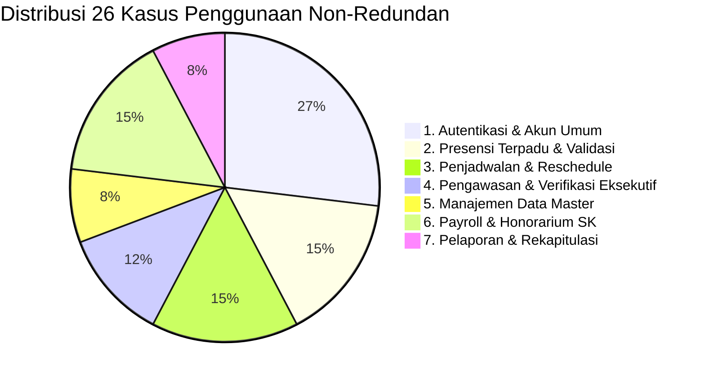

# ANALISIS LENGKAP ARSITEKTUR USE CASE DIAGRAM & SKENARIO SISTEM PRESENSI PKBM PIKAT
## Dokumentasi UML 2.5 Bebas Redundansi (Standardisasi Entitas Murid, Generalisasi Aktor, Abstraksi Presensi & Dashboard, Diagram Visual Mermaid, dan Skenario Baku)

---

### 1. INFORMASI & METADATA DOKUMEN
- **Nama Perangkat Lunak:** Sistem Informasi Presensi Digital PKBM Pikat (Presensi Pikat v2)
- **Lingkup Proyek:** Manajemen Presensi Terpadu Multi-Peran, Multi-Moda KBM, Geofencing Multi-Titik, Penjadwalan & Reschedule, Payroll Honorarium SK, Verifikasi Eksekutif, Integrasi SSO SIMPIKAT, dan Pelaporan Terpadu.
- **Standar Notasi:** Unified Modeling Language (UML) Versi 2.5
- **Standar Terminologi Entitas:** Pembakuan sebutan peserta ajar menjadi **Murid** di seluruh aktor, use case, diagram, dan skenario.
- **Prinsip Perancangan:** **Orthogonal & Zero-Redundancy** (Menghilangkan duplikasi use case dengan memanfaatkan Pewarisan/Generalisasi Aktor serta Use Case Abstraction untuk fungsionalitas bersama seperti Dashboard, Presensi Masuk/Pulang, Riwayat, dan Profil).
- **Bahasa Notasi:** Bahasa Indonesia Baku
- **Tanggal Analisis:** 08 Oktober 2026
- **Status Dokumen:** Resmi & Terverifikasi (Comprehensive System Baseline)

---

### 2. STRUKTUR AKTOR SISTEM & HIERARKI GENERALISASI

Dalam standar UML 2.5, seluruh fungsi umum sistem yang dapat diakses oleh semua pengguna (seperti **Autentikasi, Dashboard Ringkasan, Presensi Masuk, Presensi Pulang, Riwayat Presensi, dan Pengelolaan Profil/Sandi**) dimodelkan satu kali dan diasosiasikan ke aktor umum **Pengguna Terautentikasi**. 

Aktor-aktor khusus kemudian **mewarisi (*Generalization*)** seluruh kapabilitas tersebut, dan hanya diasosiasikan ke Use Case yang benar-benar spesifik bagi peran bisnisnya masing-masing.

```mermaid
classDiagram
    direction BT

    class PenggunaTerautentikasi {
        <<actor: Aktor Basis Umum>>
        +Melakukan Autentikasi Pengguna
        +Melakukan Keluar Sistem
        +Mengakses Dashboard & Ringkasan Aktivitas
        +Melakukan Presensi Masuk (Check-In)
        +Melakukan Presensi Pulang (Check-Out)
        +Melihat Riwayat Presensi Pribadi
        +Mengelola Profil & Kata Sandi
        +Mengelola Langganan Notifikasi Web Push
    }

    class Administrator {
        <<actor: Spesialisasi Peran>>
        +Mengelola Data Master Lembaga (Data Murid, Kelas, dll)
        +Mencatat Perizinan Pengguna
        +Mengelola Kategori Tutorial & Tarif SK
        +Merekapitulasi Payroll Honorarium SK
        +Mengirimkan Broadcast Notifikasi Payroll
        +Mengelola Pusat Laporan Presensi Terpadu
    }

    class KepalaSekolah {
        <<actor: Spesialisasi Peran>>
        +Memantau Analitik Kehadiran Real-Time (KPI)
        +Memverifikasi Pengajuan Lupa Lapor
        +Memverifikasi Pengajuan Izin / Sakit
    }

    class TutorPengajar {
        <<actor: Spesialisasi Peran>>
        +Mengelola Pola Jadwal & Sesi Belajar Murid
        +Mereschedule Sesi Pembelajaran
        +Mengajukan Kehadiran Retroaktif (Lupa Lapor)
        +Mengajukan Permohonan Izin / Sakit
    }

    class Murid {
        <<actor: Spesialisasi Peran>>
        +Melihat Kalender Sesi Belajar Mandiri
    }

    class MahasiswaMagang {
        <<actor: Spesialisasi Peran>>
        +Melakukan Presensi Shift Magang
    }

    class PortalSIMPIKAT {
        <<actor: Sistem Eksternal>>
        +Penyedia Identitas SSO (HMAC Token)
    }

    class WebPushService {
        <<actor: Layanan Eksternal>>
        +Gateway Notifikasi Peramban (VAPID)
    }

    Administrator --|> PenggunaTerautentikasi : Generalisasi
    KepalaSekolah --|> PenggunaTerautentikasi : Generalisasi
    TutorPengajar --|> PenggunaTerautentikasi : Generalisasi
    Murid --|> PenggunaTerautentikasi : Generalisasi
    MahasiswaMagang --|> PenggunaTerautentikasi : Generalisasi
```



#### Tabel Hak Akses & Matriks Kewenangan Aktor

| Nama Aktor Baku | Tipe Aktor | Hubungan Relasi | Lingkup Kewenangan & Fungsionalitas Bisnis |
|:---|:---|:---|:---|
| **Pengguna Terautentikasi** | Aktor Basis | Induk Generalisasi | Mewadahi fungsi bersama seluruh akun: Login, Logout, Dashboard Ringkasan, Presensi Masuk/Pulang, Riwayat Presensi, Edit Profil, dan Push Notifikasi. |
| **Administrator** | Aktor Khusus | Turunan *(Inheritance)* | Mewarisi fungsi basis + Pengelolaan Data Master Lembaga (Data Murid, Kelas, Jenjang Paket, Pengguna), Tarif SK, Payroll Honorarium, Pencatatan Izin, dan Pelaporan Terpadu. |
| **Kepala Sekolah** | Aktor Khusus | Turunan *(Inheritance)* | Mewarisi fungsi basis + Pemantauan KPI Analytics, Verifikasi Pengesahan Lupa Lapor & Izin, serta Pengesahan Laporan Resmi. |
| **Tutor Pengajar** | Aktor Khusus | Turunan *(Inheritance)* | Mewarisi fungsi basis + Pengelolaan Jadwal KBM Murid, Reschedule Sesi Pengganti, Pengajuan Lupa Lapor, dan Pengajuan Izin Mandiri. |
| **Murid** | Aktor Khusus | Turunan *(Inheritance)* | Mewarisi fungsi basis (Presensi masuk mandiri divalidasi ketat terhadap jadwal sesi KBM hari ini) + Melihat Kalender Belajar Mandiri. |
| **Mahasiswa Magang** | Aktor Khusus | Turunan *(Inheritance)* | Mewarisi fungsi basis (Presensi masuk/pulang harian divalidasi terhadap jam shift kerja dan titik lokasi resmi). |
| **Portal SIMPIKAT SSO** | Aktor Eksternal | Asosiasi Sistem | Menyediakan otentikasi lintas sistem via token HMAC-SHA256 untuk memicu login SSO Inbound dan JIT Provisioning akun murid dan tutor. |
| **Layanan Web Push (VAPID)** | Aktor Eksternal | Asosiasi Layanan | Menerima payload dari backend Laravel untuk mengirimkan push notifikasi real-time ke peramban pengguna. |

---

### 3. KATALOG KASUS PENGGUNAAN BERSIH (26 ORTHOGONAL USE CASES)

Dengan mengeliminasi redundansi dan menstandarisasi entitas Murid, sistem direpresentasikan secara elegan oleh **26 Kasus Penggunaan** yang terbagi ke dalam **7 Modul Batasan Sistem**:



#### Tabel Rinci 26 Kasus Penggunaan Bebas Redundansi

| ID Use Case | Nama Kasus Penggunaan Baku | Modul Sistem | Aktor Utama yang Berasosiasi | Relasi UML | Penjelasan & Standarisasi Entitas Murid |
|:---|:---|:---|:---|:---|:---|
| **UC-01** | Melakukan Autentikasi Pengguna | Autentikasi & Akun | Pengguna Terautentikasi | Asosiasi | Satu use case login multi-identifier untuk seluruh 5 peran akun (termasuk Murid). |
| **UC-02** | Masuk via Single Sign-On (SSO) SIMPIKAT | Autentikasi & Akun | Portal SIMPIKAT SSO | Asosiasi / `<<include>>` | `UC-02` `<<include>>` `UC-01`. Menangani JIT Provisioning akun murid dan tutor otomatis. |
| **UC-03** | Melakukan Keluar Sistem (Logout) | Autentikasi & Akun | Pengguna Terautentikasi | Asosiasi | Invalidation session & token untuk seluruh peran akun. |
| **UC-04** | Mengakses Dashboard & Ringkasan Aktivitas | Autentikasi & Akun | Pengguna Terautentikasi | Asosiasi | **Satu use case terpadu**: Menampilkan ringkasan metrik sesuai peran aktif (termasuk dashboard murid). |
| **UC-05** | Mengelola Profil & Kata Sandi | Autentikasi & Akun | Pengguna Terautentikasi | Asosiasi | **Satu use case terpadu**: Pembaruan biodata, foto, dan kata sandi mandiri. |
| **UC-06** | Melihat Riwayat Presensi Pribadi | Autentikasi & Akun | Pengguna Terautentikasi | Asosiasi | **Satu use case terpadu**: Log riwayat kehadiran untuk Murid, Tutor, Magang, Pegawai. |
| **UC-07** | Mengelola Langganan Notifikasi Web Push | Autentikasi & Akun | Pengguna Terautentikasi, Web Push | Asosiasi | Pendaftaran dan pembatalan token langganan VAPID peramban. |
| **UC-08** | Melakukan Presensi Masuk (Check-In) | Presensi Terpadu | Pengguna Terautentikasi | Asosiasi | **Satu use case terpadu**: Absensi masuk swafoto & GPS (Murid, Tutor, Pegawai, Magang). |
| **UC-09** | Melakukan Presensi Pulang (Check-Out) | Presensi Terpadu | Pengguna Terautentikasi | Asosiasi | **Satu use case terpadu**: Absensi kepulangan swafoto & GPS setelah durasi/shift selesai. |
| **UC-10** | Memvalidasi Lokasi GPS & Swafoto Kamera Depan | Presensi Terpadu | Sistem Backend | `<<include>>` | Disertakan mutlak oleh `UC-08` dan `UC-09` (Haversine radius & face capture). |
| **UC-11** | Memvalidasi Ketentuan & Aturan Presensi | Presensi Terpadu | Sistem Backend | `<<include>>` | Disertakan oleh `UC-08`/`UC-09` (Cek durasi 60m tutor, strict gating murid, shift magang). |
| **UC-12** | Mengelola Pola Jadwal & Sesi Belajar | Penjadwalan & KBM | Tutor Pengajar, Administrator | Asosiasi | Pola rutin mingguan, generate sesi kalender murid, impor/ekspor jadwal Excel. |
| **UC-13** | Mereschedule Sesi Pembelajaran | Penjadwalan & KBM | Tutor Pengajar | `<<extend>>` | Memperluas `UC-12` (Titik Perluasan: *Bentrok Jam / Tutor Berhalangan*, kirim notifikasi ke Murid). |
| **UC-14** | Mengajukan Kehadiran Retroaktif (Lupa Lapor) | Penjadwalan & KBM | Tutor Pengajar | `<<extend>>` | Memperluas `UC-09` (Titik Perluasan: *Terlewat Jam Pulang / Lupa Checkout*). |
| **UC-15** | Mengajukan Permohonan Izin / Sakit | Penjadwalan & KBM | Tutor Pengajar, Administrator | Asosiasi | Form permohonan izin tidak mengajar disertai dokumen bukti. |
| **UC-16** | Memantau Analitik Kehadiran Real-Time (KPI) | Eksekutif & Verifikasi | Kepala Sekolah | Asosiasi | Visual chart tren kehadiran murid & tutor, komposisi moda, jenjang paket. |
| **UC-17** | Memverifikasi Pengajuan Lupa Lapor | Eksekutif & Verifikasi | Kepala Sekolah | Asosiasi | Persetujuan atau penolakan permohonan kehadiran retroaktif tutor. |
| **UC-18** | Memverifikasi Pengajuan Izin / Sakit | Eksekutif & Verifikasi | Kepala Sekolah | Asosiasi | Persetujuan atau penolakan izin/sakit tutor dan pegawai lembaga. |
| **UC-19** | Mengelola Data Master Lembaga | Manajemen Master Data | Administrator | Asosiasi | Pengelolaan Data Murid, Kelas 1-12, Jenjang Paket, Pengguna, Magang, Lokasi, Shift. |
| **UC-20** | Mencatat Perizinan Pengguna | Manajemen Master Data | Administrator | Asosiasi | Pencatatan manual perizinan tutor/pegawai langsung oleh administrator. |
| **UC-21** | Mengelola Kategori Tutorial & Tarif SK | Payroll & Honorarium | Administrator | Asosiasi | Konfigurasi 6 kategori tutorial flat SK dan standar tarif sesi mengajar murid. |
| **UC-22** | Merekapitulasi Payroll Honorarium SK | Payroll & Honorarium | Administrator | Asosiasi | Generator perhitungan honor otomatis berbasis presensi bimbingan murid sah ($\ge 60$m). |
| **UC-23** | Mengunduh Rekapitulasi Payroll & Slip Honor | Payroll & Honorarium | Administrator, Kepala Sekolah, Tutor | Asosiasi | Ekspor rekapitulasi Excel/PDF lembaga dan unduh slip honor pribadi tutor. |
| **UC-24** | Mengirimkan Broadcast Notifikasi Payroll | Payroll & Honorarium | Administrator, Web Push | Asosiasi | Pengiriman notifikasi push peramban saat slip honor bulanan diterbitkan. |
| **UC-25** | Mengelola Pusat Laporan Presensi Terpadu | Pelaporan Terpadu | Administrator, Kepala Sekolah | Asosiasi | Antarmuka filter multi-entitas (Murid, Tutor, Pegawai, Magang) dan buku induk 1-31. |
| **UC-26** | Mengunduh Laporan Presensi Format Excel & PDF Resmi | Pelaporan Terpadu | Administrator, Kepala Sekolah | Asosiasi | Ekspor spreadsheet XLSX dan dokumen PDF A4 Landscape legal ber-KOP resmi. |

---

### 4. DIAGRAM VISUAL USE CASE STANDAR UML 2.5 (MERMAID.JS)

```mermaid
flowchart TB
    %% Definisi Aktor Sistem
    subgraph Aktor_Sistem [" Aktor Sistem & Pengguna Eksternal "]
        direction TB
        Actor_Base(("Pengguna Terautentikasi\n(Aktor Basis)"))
        Actor_Admin(("Administrator\n(Admin)"))
        Actor_Kepsek(("Kepala Sekolah\n(Kepsek)"))
        Actor_Tutor(("Tutor Pengajar\n(Tutor)"))
        Actor_Murid(("Murid\n(Peserta Ajar)"))
        Actor_Magang(("Mahasiswa Magang\n/ Pegawai"))
        Actor_SIMPIKAT["<<system>>\nPortal SIMPIKAT SSO"]
        Actor_WebPush["<<service>>\nWeb Push Gateway"]
    end

    %% Hierarki Generalisasi Aktor (Inheritance)
    Actor_Admin -- "|>" Actor_Base
    Actor_Kepsek -- "|>" Actor_Base
    Actor_Tutor -- "|>" Actor_Base
    Actor_Murid -- "|>" Actor_Base
    Actor_Magang -- "|>" Actor_Base

    %% Batasan Sistem Aplikasi Presensi Digital PKBM Pikat
    subgraph Batasan_Sistem [" Batasan Sistem: Sistem Presensi Digital PKBM Pikat "]
        direction TB

        %% Paket 1: Fungsionalitas Umum (Inherited via PenggunaTerautentikasi)
        subgraph Paket_Umum [" 1. Paket Autentikasi & Akun Umum "]
            UC_01(["UC-01: Melakukan Autentikasi Pengguna"]):::generalUC
            UC_02(["UC-02: Masuk via SSO SIMPIKAT"]):::generalUC
            UC_03(["UC-03: Melakukan Keluar Sistem (Logout)"]):::generalUC
            UC_04(["UC-04: Mengakses Dashboard & Ringkasan Aktivitas"]):::generalUC
            UC_05(["UC-05: Mengelola Profil & Kata Sandi"]):::generalUC
            UC_06(["UC-06: Melihat Riwayat Presensi Pribadi"]):::generalUC
            UC_07(["UC-07: Mengelola Langganan Notifikasi Web Push"]):::generalUC
        end

        %% Paket 2: Presensi Terpadu & Validasi
        subgraph Paket_Presensi [" 2. Paket Presensi Terpadu "]
            UC_08(["UC-08: Melakukan Presensi Masuk (Check-In)"]):::presensiUC
            UC_09(["UC-09: Melakukan Presensi Pulang (Check-Out)"]):::presensiUC
            UC_10(["UC-10: Memvalidasi Lokasi GPS & Swafoto"]):::includeUC
            UC_11(["UC-11: Memvalidasi Ketentuan & Aturan Presensi"]):::includeUC
        end

        %% Paket 3: Penjadwalan & Reschedule KBM
        subgraph Paket_Jadwal [" 3. Paket Penjadwalan & Alur KBM Murid "]
            UC_12(["UC-12: Mengelola Pola Jadwal & Sesi Belajar"]):::tutorUC
            UC_13(["UC-13: Mereschedule Sesi Pembelajaran"]):::extendUC
            UC_14(["UC-14: Mengajukan Kehadiran Retroaktif (Lupa Lapor)"]):::extendUC
            UC_15(["UC-15: Mengajukan Permohonan Izin / Sakit"]):::tutorUC
        end

        %% Paket 4: Verifikasi & Pengawasan Eksekutif
        subgraph Paket_Eksekutif [" 4. Paket Pengawasan & Verifikasi Eksekutif "]
            UC_16(["UC-16: Memantau Analitik Kehadiran Real-Time"]):::kepsekUC
            UC_17(["UC-17: Memverifikasi Pengajuan Lupa Lapor"]):::kepsekUC
            UC_18(["UC-18: Memverifikasi Pengajuan Izin / Sakit"]):::kepsekUC
        end

        %% Paket 5: Manajemen Data Master Lembaga
        subgraph Paket_Master [" 5. Paket Manajemen Data Master "]
            UC_19(["UC-19: Mengelola Data Master Lembaga"]):::adminUC
            UC_20(["UC-20: Mencatat Perizinan Pengguna"]):::adminUC
        end

        %% Paket 6: Payroll & Honorarium SK
        subgraph Paket_Payroll [" 6. Paket Payroll & Honorarium SK "]
            UC_21(["UC-21: Mengelola Kategori Tutorial & Tarif SK"]):::adminUC
            UC_22(["UC-22: Merekapitulasi Payroll Honorarium SK"]):::adminUC
            UC_23(["UC-23: Mengunduh Rekapitulasi Payroll & Slip Honor"]):::adminUC
            UC_24(["UC-24: Mengirimkan Broadcast Notifikasi Payroll"]):::adminUC
        end

        %% Paket 7: Pelaporan Terpadu
        subgraph Paket_Laporan [" 7. Paket Pelaporan & Rekapitulasi Terpadu "]
            UC_25(["UC-25: Mengelola Pusat Laporan Presensi Terpadu"]):::reportUC
            UC_26(["UC-26: Mengunduh Laporan Format Excel & PDF Resmi"]):::reportUC
        end
    end

    %% Relasi Asosiasi Aktor Basis (Diwariskan ke Semua Aktor Turunan)
    Actor_Base --- UC_01
    Actor_Base --- UC_03
    Actor_Base --- UC_04
    Actor_Base --- UC_05
    Actor_Base --- UC_06
    Actor_Base --- UC_07
    Actor_Base --- UC_08
    Actor_Base --- UC_09

    %% Relasi Asosiasi Sistem Eksternal
    Actor_SIMPIKAT --- UC_02
    Actor_WebPush --- UC_07
    Actor_WebPush --- UC_24

    %% Relasi Asosiasi Khusus Tutor
    Actor_Tutor --- UC_12
    Actor_Tutor --- UC_15
    Actor_Tutor --- UC_23

    %% Relasi Asosiasi Khusus Kepala Sekolah
    Actor_Kepsek --- UC_16
    Actor_Kepsek --- UC_17
    Actor_Kepsek --- UC_18
    Actor_Kepsek --- UC_23
    Actor_Kepsek --- UC_25
    Actor_Kepsek --- UC_26

    %% Relasi Asosiasi Khusus Administrator
    Actor_Admin --- UC_12
    Actor_Admin --- UC_19
    Actor_Admin --- UC_20
    Actor_Admin --- UC_21
    Actor_Admin --- UC_22
    Actor_Admin --- UC_23
    Actor_Admin --- UC_24
    Actor_Admin --- UC_25
    Actor_Admin --- UC_26

    %% Relasi <<include>> (Mandatory Inclusion)
    UC_02 -. "<<include>>" .-> UC_01
    UC_08 -. "<<include>>" .-> UC_10
    UC_08 -. "<<include>>" .-> UC_11
    UC_09 -. "<<include>>" .-> UC_10
    UC_09 -. "<<include>>" .-> UC_11

    %% Relasi <<extend>> (Conditional Extension)
    UC_13 -. "<<extend>>\n(Titik Perluasan:\nBentrok Jam / Berhalangan)" .-> UC_12
    UC_14 -. "<<extend>>\n(Titik Perluasan:\nTerlewat Jam Pulang)" .-> UC_09

    %% Definisi Style Visual
    classDef generalUC fill:#f8fafc,stroke:#64748b,stroke-width:1.5px,color:#0f172a;
    classDef presensiUC fill:#ecfdf5,stroke:#059669,stroke-width:2px,color:#064e3b;
    classDef includeUC fill:#eff6ff,stroke:#2563eb,stroke-width:1.5px,stroke-dasharray: 4 4,color:#1e3a8a;
    classDef extendUC fill:#fffbeb,stroke:#d97706,stroke-width:1.5px,stroke-dasharray: 4 4,color:#78350f;
    classDef tutorUC fill:#f0fdf4,stroke:#16a34a,stroke-width:1.5px,color:#14532d;
    classDef kepsekUC fill:#f5f3ff,stroke:#7c3aed,stroke-width:1.5px,color:#4c1d95;
    classDef adminUC fill:#fdf2f8,stroke:#db2777,stroke-width:1.5px,color:#831843;
    classDef reportUC fill:#fef2f2,stroke:#dc2626,stroke-width:1.5px,color:#7f1d1d;
```

---

### 5. SPESIFIKASI FORMAL SKENARIO KASUS PENGGUNAAN (USE CASE SCENARIOS)

Berikut adalah skenario formal terstandar untuk kasus-kasus penggunaan inti sistem yang telah bebas dari duplikasi dan menggunakan istilah baku **Murid**:

---

#### 5.1. Skenario `UC-04`: Mengakses Dashboard & Ringkasan Aktivitas (Unified Dashboard)

| Elemen Skenario | Rincian Spesifikasi Formal |
|:---|:---|
| **ID & Nama Kasus Penggunaan** | **`UC-04` Mengakses Dashboard & Ringkasan Aktivitas** |
| **Modul Sistem** | Modul 1: Autentikasi & Akun Umum |
| **Tingkat Prioritas** | **Tinggi (Pengalaman Pengguna Utama)** |
| **Aktor Utama** | Pengguna Terautentikasi (*Administrator, Tutor, Kepsek, Murid, Magang*) |
| **Aktor Pendukung** | Sistem Backend (AnalyticsService, DashboardController) |
| **Deskripsi Singkat** | Pengguna mengakses halaman beranda (*dashboard*) sistem untuk melihat ringkasan metrik kehadiran, status sesi aktif hari ini, jadwal mendatang, dan pintasan menu operasional sesuai hak akses perannya. |
| **Kondisi Prasyarat (*Pre-Conditions*)** | Pengguna telah berhasil login dan memiliki sesi otentikasi aktif. |
| **Kondisi Pasca (*Post-Conditions*)** | Sistem merender antarmuka dashboard yang terpersonalisasi sesuai peran pengguna (`role`) dengan data statistik terkini. |
| **Pemicu (*Trigger*)** | Pengguna selesai login atau mengklik menu navigasi *"Dashboard"*. |
| **Alur Utama (*Main / Normal Flow*)** | 1. Pengguna membuka rute `/dashboard` atau diarahkan otomatis pasca login.<br>2. Sistem mendeteksi nilai `auth()->user()->role`.<br>3. Sistem mengagregasi data ringkasan spesifik peran:<br>   - **Admin:** Statistik total murid/tutor/karyawan, grafik mingguan presensi, dan log aktivitas terkini.<br>   - **Kepala Sekolah:** Visual chart tren kehadiran, metrik rasio per jenjang paket murid, dan badge pengajuan pending.<br>   - **Tutor:** Jadwal sesi KBM murid hari ini, hitung mundur sesi aktif, dan rekap jam mengajar bulan berjalan.<br>   - **Murid:** Informasi sesi belajar aktif hari ini, status presensi mandiri murid, dan ringkasan kehadiran.<br>   - **Magang:** Jadwal shift kerja hari ini, status check-in/check-out, dan total kehadiran.<br>4. Sistem menampilkan halaman dashboard lengkap dengan kartu ringkasan, banner status, dan tombol aksi cepat. |
| **Alur Alternatif (*Alternative Flow*)** | **A-1: Deteksi Sesi Lampau Belum Checkout (Tutor/Pegawai)**<br>Jika terdeteksi sesi presensi hari kemarin yang belum di-checkout, sistem menyematkan banner peringatan interaktif dengan tombol langsung menuju form Lupa Lapor (`UC-14`). |
| **Alur Pengecualian (*Exception Flow*)** | **E-1: Sesi Kedaluwarsa**<br>Jika sesi pengguna habis saat mengakses dashboard, sistem mengalihkan ke `/login` dengan flash message: *"Sesi Anda telah berakhir. Silakan masuk kembali."* |
| **Titik Perluasan (*Extension Points*)** | Tidak ada. |
| **Aturan Bisnis (*Business Rules*)** | 1. Setiap peran pengguna disajikan dashboard terisolasi via kontrol akses middleware `role:admin|tutor|kepala_sekolah|magang|murid,siswa`.<br>2. Data analitik di-cache atau diagregasikan secara efisien tanpa blocking I/O. |
| **Pemetaan Kode Laravel** | - **Route:** `GET /dashboard`, `GET /admin/dashboard`, `GET /tutor/dashboard`, `GET /kepsek/dashboard`, `GET /magang/dashboard`, `GET /murid/dashboard` (alias: `GET /siswa/dashboard`)<br>- **Controllers:** `DashboardController.php`, `TutorDashboardController.php`, `KepsekDashboardController.php`, `MagangDashboardController.php`, `MuridDashboardController.php`<br>- **Service:** `app/Services/AnalyticsService.php` |

---

#### 5.2. Skenario `UC-08`: Melakukan Presensi Masuk (Check-In) (Unified Check-In)

| Elemen Skenario | Rincian Spesifikasi Formal |
|:---|:---|
| **ID & Nama Kasus Penggunaan** | **`UC-08` Melakukan Presensi Masuk (Check-In)** |
| **Modul Sistem** | Modul 2: Presensi Terpadu & Validasi |
| **Tingkat Prioritas** | **Tinggi (Kritis / Inti Sistem)** |
| **Aktor Utama** | Pengguna Terautentikasi (*Tutor, Murid, Administrator, Kepala Sekolah, Magang*) |
| **Aktor Pendukung** | Sistem Backend (PresensiFotoController, GeofencingService, ShiftPresensiService) |
| **Deskripsi Singkat** | Pengguna melakukan pencatatan kehadiran masuk dengan menangkap swafoto kamera depan dan memverifikasi koordinat GPS terhadap aturan titik lokasi presensi resmi lembaga. |
| **Kondisi Prasyarat (*Pre-Conditions*)** | 1. Pengguna telah login dan membuka menu presensi.<br>2. Pengguna belum memiliki sesi presensi masuk yang aktif pada saat bersamaan.<br>3. Izin kamera depan dan lokasi GPS aktif pada peramban/perangkat. |
| **Kondisi Pasca (*Post-Conditions*)** | 1. Record kehadiran baru tersimpan di tabel `presensi` (atau `presensi_mandiri_murid` / `presensi_karyawan`).<br>2. Nilai `jam_mulai` tercatat otomatis menggunakan waktu server WIB (`Asia/Jakarta`).<br>3. Berkas swafoto tersimpan di storage publik dan status presensi disetel aktif/pending. |
| **Pemicu (*Trigger*)** | Pengguna menekan tombol *"Presensi Masuk (Check-In)"*. |
| **Alur Utama (*Main Flow*)** | 1. Pengguna membuka form presensi kamera.<br>2. Sistem memuat parameter kontekstual peran:<br>   - **Tutor:** Pilihan murid bimbingan, moda pembelajaran (*Sekolah / Kunjungan Rumah / Daring*), dan titik lokasi resmi.<br>   - **Murid:** Penguncian otomatis terhadap jadwal sesi aktif hari ini dan titik lokasi sesi KBM.<br>   - **Pegawai/Magang:** Shift kerja aktif dan titik lokasi tugas.<br>3. Sistem mengaktifkan kamera depan dan mendeteksi koordinat GPS riil pengguna.<br>4. **Include `UC-10 Memvalidasi Lokasi GPS & Swafoto`**: Sistem memeriksa radius lokasi via rumus Haversine.<br>5. **Include `UC-11 Memvalidasi Ketentuan & Aturan Presensi`**: Sistem memvalidasi kelaikan aturan khusus (misal: bebas radius untuk Admin/Kepsek, atau strict gating untuk Murid).<br>6. Pengguna mengambil swafoto dan menekan *"Kirim Presensi"*.<br>7. Sistem menyimpan berkas foto, mencatat timestamp WIB server, dan menyimpan record kehadiran.<br>8. Sistem menampilkan notifikasi sukses dan mengarahkan pengguna ke halaman pemantauan sesi. |
| **Alur Alternatif (*Alternative Flow*)** | **A-1: Moda Kunjungan Rumah (Tutor ke Rumah Murid)**<br>Tutor memilih moda Kunjungan Rumah. Sistem mencatat titik koordinat GPS rumah murid dan membebaskan batasan radius titik sekolah.<br>**A-2: Pembelajaran Daring (Tutor)**<br>Tutor memilih moda Daring. Sistem menonaktifkan batasan radius GPS dan mewajibkan lampiran link pertemuan (Zoom/GMeet).<br>**A-3: Bebas Radius Dinas Luar (Admin & Kepala Sekolah)**<br>Sistem mendeteksi peran Admin/Kepsek. Sistem mengaktifkan status Bebas Radius Aktif (Tugas Dinas/Rapat) dan tetap mencatat koordinat riil tanpa memblokir absensi. |
| **Alur Pengecualian (*Exception Flow*)** | **E-1: Lokasi di Luar Radius Toleransi**<br>Sistem menolak submit dan menampilkan jarak riil pengguna terhadap titik lokasi resmi.<br>**E-2: Murid Tidak Terjadwal Hari Ini**<br>Sistem mengunci form presensi murid dan menampilkan peringatan ketiadaan jadwal KBM aktif. |
| **Titik Perluasan (*Extension Points*)** | Tidak ada. |
| **Aturan Bisnis (*Business Rules*)** | 1. Swafoto wajib menggunakan kamera depan (*front-facing camera*).<br>2. Jam masuk wajib bersumber dari jam server internal WIB, bukan jam gawai pengguna. |
| **Pemetaan Kode Laravel** | - **Routes:** `POST /tutor/presensi`, `POST /murid/presensi` (alias: `POST /siswa/presensi`), `POST /magang/presensi`, `POST /admin/presensi`, `POST /kepsek/presensi`<br>- **Controllers:** `PresensiFotoController.php`, `MuridPresensiController.php`, `MagangPresensiController.php`, `KaryawanPresensiController.php`<br>- **Services:** `GeofencingService.php`, `ShiftPresensiService.php`, `PresensiService.php` |

---

#### 5.3. Skenario `UC-09`: Melakukan Presensi Pulang (Check-Out) (Unified Check-Out)

| Elemen Skenario | Rincian Spesifikasi Formal |
|:---|:---|
| **ID & Nama Kasus Penggunaan** | **`UC-09` Melakukan Presensi Pulang (Check-Out)** |
| **Modul Sistem** | Modul 2: Presensi Terpadu & Validasi |
| **Tingkat Prioritas** | **Tinggi (Kritis / Pengesahan Jam Selesai)** |
| **Aktor Utama** | Pengguna Terautentikasi (*Tutor, Administrator, Kepala Sekolah, Magang*) |
| **Aktor Pendukung** | Sistem Backend (PresensiFotoController, PayrollService) |
| **Deskripsi Singkat** | Pengguna menyelesaikan sesi kerja atau sesi mengajar bimbingan murid dengan mengambil swafoto kepulangan setelah memenuhi batas durasi atau jam shift kepulangan. |
| **Kondisi Prasyarat (*Pre-Conditions*)** | 1. Pengguna memiliki sesi presensi masuk aktif pada hari yang sama.<br>2. Ketentuan durasi (minimal 60 menit untuk Tutor) atau jam shift pulang telah terpenuhi. |
| **Kondisi Pasca (*Post-Conditions*)** | 1. Record presensi diperbarui: `jam_selesai` terisi waktu WIB server, `foto_selesai` terunggah, dan status berubah menjadi `hadir`.<br>2. Untuk Tutor: Sesi KBM murid terkait disinkronkan menjadi `selesai` dan siap dihitung pada honorarium SK. |
| **Pemicu (*Trigger*)** | Pengguna menekan tombol *"Presensi Pulang (Check-Out)"*. |
| **Alur Utama (*Main Flow*)** | 1. Pengguna membuka antarmuka presensi pulang pada sesi aktif.<br>2. **Include `UC-11 Memvalidasi Ketentuan & Aturan Presensi`**: Sistem memverifikasi durasi mengajar $(\ge 60\text{ menit})$ atau jam shift pulang.<br>3. Sistem mengaktifkan kamera depan dan menangkap koordinat GPS kepulangan.<br>4. **Include `UC-10 Memvalidasi Lokasi GPS & Swafoto`**: Sistem memvalidasi keabsahan swafoto dan posisi.<br>5. Pengguna mengambil foto kepulangan dan mengirim konfirmasi.<br>6. Sistem memperbarui record presensi di database dan menghitung total menit kehadiran.<br>7. Sistem menampilkan notifikasi sukses dan menutup sesi aktif hari ini. |
| **Alur Alternatif (*Alternative Flow*)** | Tidak ada. |
| **Alur Pengecualian (*Exception Flow*)** | **E-1: Durasi Belum Mencapai 60 Menit (Tutor)**<br>Sistem menolak checkout dan menyajikan hitung mundur sisa waktu mengajar yang harus dipenuhi.<br>**E-2: Terlewat Batas Hari Kalender (Lintas Hari)**<br>Jika tanggal telah berganti hari ($> 23:59\text{ WIB}$), tombol clock-out reguler terkunci dan alur dialihkan ke titik perluasan `UC-14`. |
| **Titik Perluasan (*Extension Points*)** | **Titik Perluasan: Terlewat Jam Pulang / Lupa Checkout Lintas Hari**<br>Diperluas oleh use case **`UC-14 Mengajukan Kehadiran Retroaktif (Lupa Lapor)`**. |
| **Aturan Bisnis (*Business Rules*)** | 1. Khusus Tutor: Durasi minimal 60 menit bimbingan murid wajib terpenuhi agar kehadiran diakui sah untuk perhitungan honor SK.<br>2. Presensi pulang hanya dapat diproses pada hari kalender yang sama dengan presensi masuk. |
| **Pemetaan Kode Laravel** | - **Controllers:** `PresensiFotoController.php`, `KaryawanPresensiController.php`, `MagangPresensiController.php`<br>- **Models:** `Presensi.php`, `PresensiKaryawan.php`, `JadwalSesi.php` |

---

#### 5.4. Skenario `UC-06`: Melihat Riwayat Presensi Pribadi (Unified History)

| Elemen Skenario | Rincian Spesifikasi Formal |
|:---|:---|
| **ID & Nama Kasus Penggunaan** | **`UC-06` Melihat Riwayat Presensi Pribadi** |
| **Modul Sistem** | Modul 1: Autentikasi & Akun Umum |
| **Tingkat Prioritas** | Sedang (Transparansi Akun) |
| **Aktor Utama** | Pengguna Terautentikasi (*Murid, Tutor, Magang, Pegawai*) |
| **Aktor Pendukung** | Sistem Backend (Eloquent Models) |
| **Deskripsi Singkat** | Pengguna membuka log catatan kehadiran historis dirinya untuk meninjau status hadir/izin, jam mulai/selesai, moda belajar, titik lokasi, dan foto bukti kehadiran. |
| **Kondisi Prasyarat (*Pre-Conditions*)** | Pengguna telah login dengan akun aktif. |
| **Kondisi Pasca (*Post-Conditions*)** | Sistem menyajikan tabel/daftar kartu riwayat presensi yang terfilter sesuai identitas akun pengguna. |
| **Pemicu (*Trigger*)** | Pengguna mengklik menu navigasi *"Riwayat Presensi"*. |
| **Alur Utama (*Main Flow*)** | 1. Pengguna membuka rute `/tutor/riwayat`, `/murid/riwayat` (alias: `/siswa/riwayat`), atau `/magang/riwayat`.<br>2. Sistem memfilter data kehadiran dari database berdasarkan `user_id` atau relasi profil pengguna yang sedang login.<br>3. Pengguna dapat memilih filter bulan, tahun, atau status kehadiran.<br>4. Sistem menampilkan daftar kehadiran historis lengkap dengan badge status (`Hadir`, `Pending`, `Izin`), jam WIB, thumbnail swafoto, dan rincian lokasi.<br>5. Pengguna dapat mengklik kartu riwayat untuk melihat modal detail presensi. |
| **Alur Alternatif (*Alternative Flow*)** | Tidak ada. |
| **Alur Pengecualian (*Exception Flow*)** | **E-1: Belum Ada Riwayat Kehadiran**<br>Sistem menampilkan komponen *Empty State* terstandar dengan ikon lembut dan pesan informatif. |
| **Titik Perluasan (*Extension Points*)** | Tidak ada. |
| **Aturan Bisnis (*Business Rules*)** | Pengguna hanya dapat melihat data riwayat miliknya sendiri (*Strict Data Isolation*). |
| **Pemetaan Kode Laravel** | - **Routes:** `GET /tutor/riwayat`, `GET /murid/riwayat` (alias: `GET /siswa/riwayat`), `GET /magang/riwayat`<br>- **Controllers:** `TutorDashboardController.php@riwayat`, `MuridDashboardController.php@riwayat`, `MagangDashboardController.php@riwayat` |

---

### 6. RANGKUMAN MANFAAT PENDEKATAN BEBAS REDUNDANSI & STANDARISASI MURID

1. **Konsistensi Terminologi (Murid)**: Seluruh referensi terhadap peserta belajar kini 100% baku dan seragam sebagai **Murid**, menciptakan kejelasan linguistik dalam seluruh dokumen teknis dan bisnis.
2. **Kepatuhan UML 2.5 yang Ketat**: Mengeliminasi anti-pattern *role-exploded use cases* di mana fungsi yang sama diulang-ulang untuk setiap nama aktor.
3. **Keterbacaan Visual yang Tinggi**: Diagram Use Case Mermaid menjadi ringkas, fokus, elegan, dan mudah dipahami oleh pemangku kepentingan maupun pengembang.
4. **Efisiensi Pemeliharaan Dokumentasi**: Perubahan aturan bisnis pada fungsi bersama (seperti validasi kamera swafoto atau sistem geofencing) cukup diperbarui pada satu skenario use case terpadu (`UC-08` / `UC-10`), tanpa harus mengubah banyak file yang terduplikasi.
